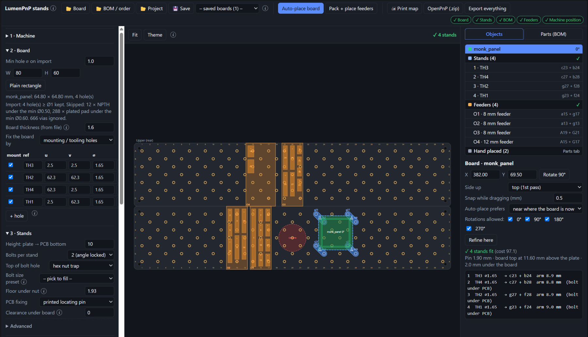
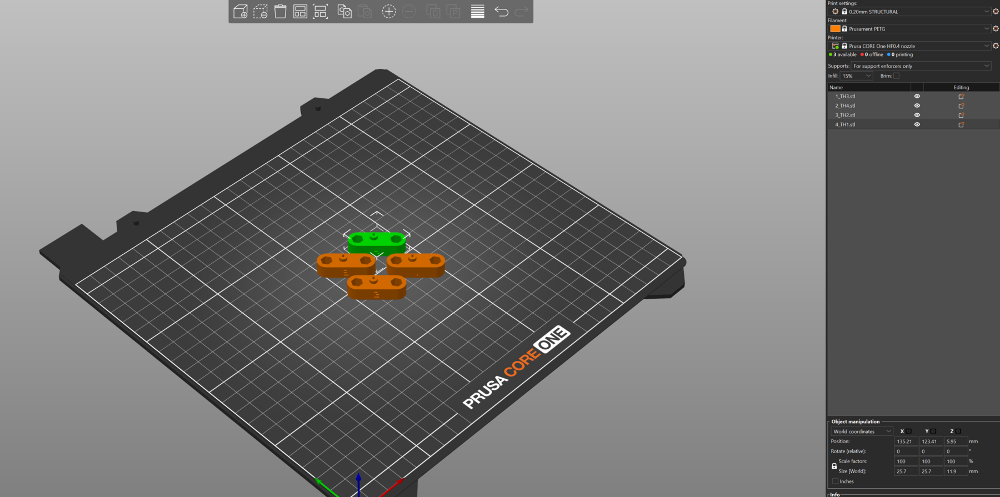

# LumenPnP PCB Stand and Discrete Tray Generator

A single-page, offline tool for the [Opulo LumenPnP](https://github.com/opulo-inc/lumenpnp) staging plates. From a KiCad
`.kicad_pcb` (and optionally its BOM) it:

- places the board on the plate grid and generates **3D-printable PCB stands** (STL / OpenSCAD) bolted into the plate holes,
  using the board's mounting holes or, with none, its corners;
- packs the BOM's cut tape into **printable discrete-part trays**, or into **Opulo's printed tray feeders**, and places them
  around the board;
- exports an **OpenPnP starter project** (board, job, parts, packages, feeders, and a merge script for `~/.openpnp2`),
  optionally fitted to the machine from taught fiducials;
- prints a **placement map and loading list** for setting up the plates.





**Quick start:** clone, open `pnp_stand.html` in a browser (double-click it; it works offline). Open
`pnp_stand.html#demo` to see a sample board. Node 18+ is only needed for the CLI and the tests.

Status: used on a LumenPnP (v3.1, rev00 plates) to assemble two boards of a 64.8 mm panel with Opulo tray feeders. The
exported first-part locations land close, but expect to re-capture most of them on the machine (*Capture Camera
Location* on each feeder's first part). See *Not verified yet* at the end before trusting a default. Issues and pull
requests welcome.

Layout (like KiCad / PrusaSlicer): **top bar** = open board / BOM / project, save, *Auto-place board*, *Pack + place*,
*🖨 Print map*, OpenPnP, *Export everything*, and the step chips (click one to jump). **Left** = setup: 1 Machine, 2 Board, 3 Stands
(expert fields under *Advanced*), 4 Cut tape, 5 Machine position / OpenPnP. Placement (4 below) is the board's properties
on the right; stand export (5 below) is *Stands* on the right. **Middle** = the plates. **Right** = what's on the plates (board, each
stand, each tray / feeder, hand-placed lines) and the properties of whichever you click, there or on the plates: the
board's position, rotation and auto-place options; a stand's holes and its STL; a feeder's bolts and channel by channel
contents. *Parts (BOM)* is the line table; click a line to jump to its tray / feeder.

1. **Machine**: pick the profile (v3/v3.1 has the bottom camera in a plate; on v4 the camera is beside the plates), the
   number of plates, and for each plate its letter case and which edge A is on. The rev00 plates (as measured on ours) run A–G, then G–A on the
   next plate: lower (front) plate `a–g`, upper (rear) plate `A–G`. Grid holes are named letter + row, e.g. `d24`, `D24`.
   Keep-outs are text, one per line (`camera d20 52`, `rect d16 g19`, `block c5 e5`, …). Click a grid hole to block it.
2. **PCB**: open a `.kicad_pcb`. The Edge.Cuts outline sets the size. NPTH holes of at least the minimum diameter, and
   plated holes in `MountingHole` footprints, are listed. Tick the ones the stands should use, or add holes by hand
   (u/v from the board's lower-left corner, top view).
   The import line reports what was skipped (e.g. castellations, vias). A board with no mounting holes switches to
   **corner mode**: each stand has a square pad under a board corner and a low L-wall outside its two edges, with a relief
   hole in the wall's inside corner so a sharp board corner seats. Pick which of the 4 corners get a stand.
3. **Stand**: height, 1 or 2 bolts per stand (with 2, the stand can't swing). *Bolt size preset* fills the clearance
   hole, nut (across flats, height) and head diameter: M3 as measured (default), M2 / M2.5 / M3 / M4 ISO; the fields
   stay editable. The tray caps use the same bolt. If the nut is taller than the pocket (body top − floor under the
   nut), the placement panel says so. Hex nut trap or counterbore on top,
   printed locating pin or a blind hole for a dowel, screw or insert, max arm length.
   *Step-up* (default 2 mm): the body stops below the PCB and only a boss under the pin, or the corner pad, reaches it.
   That gives the thin pin a wide base to print on and saves material (−20 % on a test panel's stands).
   Board thickness comes from the file (`general.thickness`, editable). The pin is that thickness + *pin tip above board
   top* (0.3 mm), and in corner mode the L-wall top sits *wall top below board top* (0.4 mm) under the board's top face.
   **Double-sided boards**: for the second pass set *Side up = bottom* (the board is mirrored, and the same physical
   corner keeps its number) and *Clearance under board* = the tallest part now facing the plate. The step-up is raised
   to clear it, and the stand height too if needed; the placement panel says what changed.
   Each stand gets its number engraved on its longest side face: **1 = nearest the board's lower-left corner (KiCad
   top view), counting anticlockwise**. The number stays with the same board corner whatever rotation it's placed at.
4. **Placement**: drag the board and the stands are picked live. *Auto-place* searches the plates with the rotations you
   allowed, preferring a spot near the board's current position, near the camera, or near the front-left corner.
   *Refine here* searches ±40 mm around the current spot.
5. **Export**: a .zip with a folder holding one STL per stand (`1_H1.stl`, …; each is one closed solid), or all stands
   in one STL, or a single stand. Also editable OpenSCAD, project JSON, and the **print sheet** (*🖨 Print map*: top of the page, section 5 or 6; letter
   landscape): page 1 a map of the plates seen from above (front at the bottom, cropped to what's used) with the board,
   each stand and its grid holes, every tray / Opulo feeder with its bolt holes and each cut strip where it goes; page 2
   the loading list (per tray / feeder: lane or channel, start, cut length, line, value, refs, qty, tape) with tick
   boxes, the stands, hand-placed parts and what to do next. It shows what's on the plates when you press it, so print
   after the last drag. Optionally, jog the nozzle to one grid hole,
   enter its machine X/Y, and the tool gives the OpenPnP board location.

6. **Cut-tape trays**: open the KiCad BOM CSV (`fab/<board>_bom.csv`, Qty per board), or a **DigiKey order CSV**
   (with the .kicad_pcb open: lines come from the board's footprints, quantities from the order matched by MPN, else
   value + package; substitutions and anything not matched are listed; boards per run is set to 1 and spares to 0). Lines are grouped into one per reel by
   normalised value + footprint (100nF = 0.1uF, 4k7 = 4.7k; voltage / dielectric words ignored). Untick the lines that go on feeders or are placed by
   hand (a QFP is unticked by default: it normally comes in a JEDEC tray). Each ticked line gets one **section**: a label
   block with its line number engraved, then a channel for the cut tape, long enough for
   (qty × boards per run + spares + empty pockets at the start) × part pitch. Sections of one tape width share a lane
   end to end; lanes sit side by side in a tray. Each tray has an end cap at both ends on a grid row, with M3 bolts and
   the same nut pocket as the stands (nut 1.93 mm floor, cap tall enough for the 4 mm nut).
   *Pack + place* tries the layout using the least plate area first; if a tray doesn't fit around the board and
   stands, it tries the next layouts and narrower trays. Drag a tray to move it (it snaps to rows, 1 mm across).
   *Trays (.zip)* gives one STL per tray plus `sections.csv` (line, parts, tape, tray/lane, first-part X/Y on the plates,
   tape surface Z). The print sheet lists which tape goes in which lane.
   Tape width, pitch and carrier (paper / embossed) come from a package table (EIA-481 typical) and can be changed per
   line; ⚠ marks a guess (connectors, switches, packages by body size). Sprocket holes go toward the front of each lane.

   **Holder = Opulo LumenPnP printed tray feeders** (the default; the other choice prints our own trays). Opulo sells them as "strip feeders"
   but its own setup guide uses them as OpenPnP *tray* feeders: a pick location, a per-part offset and a count, no
   sprocket-hole vision, so a cut strip can start anywhere in a channel. Each ticked line gets a section with the same
   length rule as our trays ((parts + empty pockets) × pitch + slack, at least the shortest section); a line longer than
   a channel is split. Sections of one tape width go end to end in the channels with *Gap between sections* (5 mm)
   between them (first-fit decreasing), and channels fill feeders of that width. *Feeders you have* (`8:10 12:2`)
   reports a shortage. Under *Feeder dimensions*: *Feeder types*, one per tape width `W:channels:width across[:channel
   pitch]`, default `8:3:40:15 12:3:56.2:15 16:2:48:20 24:1:36 32:1:44` (channels from opulo.io; 8 / 12 mm width and the
   15 mm channel pitch from Opulo's FreeCAD, which the LumenPnP host's own tray feeders confirm at 14.9 mm; 16 / 24 / 32
   guessed), usable channel length (116 of 120 mm), pick Z above the plate (10.7: measured picks at 10.5–10.8 above the plate top). Feeders
   are placed like trays (draggable), one plate each, two grid holes under them ≥ 30 mm apart (90°: channels front to
   back, A15 + G15 style; 180°: along the rows). The list, *Setup CSV* and the print sheet say which line goes in which
   feeder / channel, its cut length and where it starts ("@ mm" from the back end at 90°, the left end at 180°). The
   OpenPnP export (section 7) writes a ReferenceTrayFeeder per section (`PLAN-<line>`, or `PLAN-<line>-<k>` for a
   split line): first part at the back, next parts toward the front (offset −pitch in Y, like the host's own); position
   the camera on the first part, capture, set Z and rotation.
   *Line longer than a channel* = refill (the default) gives such a line one full channel and lists how many more to slide in as
   it runs out (reset the feeder count each time) instead of splitting it over channels. Placement: every pick goes
   feeder → bottom camera → board, and only the feeder → camera leg depends on the layout, so channels and feeders are
   ordered busiest first and placed nearest the bottom camera (the `camera` keep-out); the status line shows the
   parts-weighted feeder → camera distance.

7. **OpenPnP project** (OpenPnP 2.4): a .zip with `<board>.board.xml` (placements from the .kicad_pcb, origin = board
   lower-left, fiducials kept), `<board>.job.xml` (board location from this placement), `parts.xml` / `packages.xml` (one
   part per BOM line, id = footprint-value, body size, height, Opulo nozzle tip), `feeders.xml` (a ReferenceStripFeeder
   `PLAN-<line>` per tray section) and `merge_into_openpnp.py`. With OpenPnP closed, the script adds those
   parts and packages (one the machine already has is kept: it was tuned there; only ids the script added itself,
   listed in `pnp_stand_ids.txt` in the config dir, get updated) and replaces the PLAN- feeders in `~/.openpnp2` (backup first); run it again after every re-export. Lines not in a
   tray are set to Ignore (hand place) or Place. `python3 merge_into_openpnp.py --undo` undoes one run per call.
   **Machine position** (section 7) decides how plate coordinates become machine X/Y: *taught fiducials* (type each
   fiducial's machine X/Y from the DRO, or the OpenPnP Placements-table value, plus the measured board top Z; the page
   fits a rotation + shift, shows each fiducial's residual and writes everything in machine coordinates, the same code
   as `fit_fiducials.js`), *a reference grid hole* (its machine X/Y), or *none*. The export refuses to run until the
   chosen one is filled in, and *none* asks first. *Export everything* puts stand STLs, tray STLs, the setup CSV, the
   print sheet, the OpenPnP project and the project JSON in one zip. The chips under the title show which step is
   done; long help sits behind the *i* icons.
   The XML uses only attributes older OpenPnP builds also read (a 2.x build refused `mark` on a
   footprint pad and would not start until the config was restored).

   **Fitting an export that's already out** (plate coordinates, or re-teaching later) without the page: load the job,
   jog the top camera onto each fiducial and edit that fiducial's X/Y in the Placements table until it's centred (or
   note the machine X/Y from the DRO). Then, with the exported folder:

   ```
   node fit_fiducials.js <export dir> <out dir> FIDP1=x,y FIDP2=x,y FIDP3=x,y --z <board top Z> [--fid-part <id>] [--machine]
   ```

   It fits one rotation + shift through the fiducials (residuals printed; > 0.2 mm means a fiducial was taught on the
   wrong mark), moves every placement and every strip feeder hole by it, and sets the job's board Z to the measured
   value (feeder Z moves by the same amount). The job's board location is kept, so reload the board in the open job.
   `--machine` = the values are machine X/Y, not the Placements-table values. `--fid-part` = a fiducial part id that
   already exists in that machine's config.

## Settings reference

Every setting the page saves, its key in the project JSON and the browser's saved state, and the default a new browser
starts from. Defaults marked *used on the machine* are what two boards were assembled with on a LumenPnP v3.1; the rest
are first guesses. A saved project keeps its own values, so a changed default only reaches it through *Reset stand to
defaults* or by editing the field.

**Machine** (section 1): profile `v3.1` (bottom camera in the plate, keep-out `camera d20 52`) or `v4` (camera beside
the plates); two plates, lower (front) `a–g` with a at the front, upper (rear) `A–G` with A at the rear, row 1 on the
left. Plate dimensions, under *Plate dimensions* (key `cfg.plate`):

| Setting (page) | Key | Default | Notes |
|---|---|---|---|
| Length (mm) | `length` | `600` | plate length, mm |
| Width (mm) | `width` | `120` | plate width, mm |
| Hole pitch (mm) | `pitch` | `15` | hole pitch, mm |
| First hole from edge | `edge` | `15` | first hole from the plate edge, mm |
| *(project JSON only)* | `holeD` | `3.4` | grid hole diameter, mm |
| Gap between plates | `gap` | `0` | gap between the two plates, mm |
| Plate screw inset | `screwInset` | `10` | plate screws from each corner, mm (always keep-outs) |
| Plate screw keep-out ⌀ | `screwKeepD` | `11` | keep-out diameter round each plate screw, mm |

**Stands** (section 3, expert fields under *Advanced*; key `sp`). *Bolt size preset* fills `boltD`, `nutAF`, `nutH` and
`headD`: M3 as measured (default), M2 / M2.5 / M3 / M4 ISO.

| Setting (page) | Key | Default | Notes |
|---|---|---|---|
| Height: plate → PCB bottom | `height` | `10` | plate top to PCB bottom, mm. 10 = used on the LumenPnP (2 boards): body 8 + step-up 2 |
| Wall | `wall` | `2.0` | material around holes / pockets |
| Bolt clearance ⌀ | `boltD` | `3.6` | M3 clearance (measured screw 2.89; 3.4 printed tight) |
| Top of bolt hole | `pocket` | `hex` | 'hex' nut trap at the top, 'round' counterbore for a screw head, 'none' |
| Nut across flats | `nutAF` | `5.34` | nut across flats as measured (pocketClr is added) |
| Head ⌀ | `headD` | `5.5` | M3 socket head |
| Nut height | `nutH` | `4.0` | nut height as measured; the stand pocket and the tray caps must take it |
| Pocket clearance | `pocketClr` | `0.3` | added to the nut / head pocket and the bolt hole, mm |
| Floor under nut | `pocketFloor` | `1.93` | plastic left under the nut / screw head; the pocket fills the body above it |
| Bolts per stand | `bolts` | `2` | 1 = can swing about its bolt; 2 = second bolt locks the angle |
| PCB fixing | `iface` | `pin` | 'pin' printed locating pin, 'hole' blind hole (dowel / screw / heat-set insert) |
| Pin clearance (radial) | `pinClr` | `0.25` | pin = PCB hole - 2*clr (0.15 printed tight) |
| Board thickness (from file) | `pcbThick` | `1.6` | board thickness (read from the .kicad_pcb); sets the pin length and the corner wall height |
| Pin tip above board top | `pinAbove` | `0.3` | pin tip above the board's top face (negative = stops inside the hole) |
| Blind hole ⌀ (0 = PCB hole) | `ifaceHoleD` | `0` | 'hole' mode diameter, 0 = PCB hole diameter |
| Blind hole depth | `ifaceHoleDepth` | `6` |  |
| Min pad radius under PCB | `padMin` | `3.5` | min radius of the support pad under the PCB hole |
| Max arm (PCB hole → bolt) | `maxArm` | `26` | max distance PCB hole → bolt |
| Max bolt spacing | `maxPair` | `31` | max distance between the two bolts of one stand |
| Penalty: bolt under PCB | `underPenalty` | `4` | cost added for a bolt hidden under the PCB |
| Gap between stands | `standGap` | `1.0` | min gap between two stands |
| Step-up (body below PCB by) | `stepH` | `2.0` | step-up: body top sits this far below the PCB; only a boss (or the corner pad) reaches it. 0 = flat |
| Boss ⌀ under pin (0 = auto) | `bossD` | `0` | boss under the pin / blind hole, 0 = auto (fixing + 2 x 1.4 mm, min 4.5) |
| Engrave number on side | `label` | `true` | engrave the stand number (1 = board lower-left, counting anticlockwise) into the top |
| Number height / depth | `labelH` | `4.5` | number height, mm |
| Number height / depth | `labelDepth` | `0.6` | engraving depth, mm |
| Support pad (square) | `cornerPad` | `6` | corner mode: square support under the board corner |
| Edge clearance | `cornerGap` | `0.2` | corner mode: board edge to wall clearance |
| L-wall thickness | `cornerWall` | `1.6` | corner mode: L-wall thickness |
| L-wall top below board top | `lipBelow` | `0.4` | corner mode: wall top this far below the board's top face |
| Clearance under board | `underClear` | `0` | tallest part on the board's down-facing side (2nd pass of a double-sided board), 0 = none |

**Cut tape: common** (section 4; key `tray.tp`). Loading a DigiKey order sets boards per run to 1 and spares to 0.

| Setting (page) | Key | Default | Notes |
|---|---|---|---|
| Boards per run | `boards` | `1` | boards per run |
| Spare parts per line | `spares` | `2` | extra parts per line (cut tape is never exact) |
| Empty pockets at the start | `leader` | `1` | empty pockets at the start of each strip |
| Slack at section end | `endClr` | `1.5` | slack at the end of each section, mm |
| Shortest section | `minSection` | `16` | shortest section (tape region), mm: room to handle the strip and for 3+ sprocket holes |
| Clearance to other things | `gap` | `2.0` | clearance to stands, board, keep-outs and other trays |

**Opulo tray feeders** (*Holder* = Opulo, the default):

| Setting (page) | Key | Default | Notes |
|---|---|---|---|
| Holder | `holder` | `opulo` | 'opulo' = Opulo LumenPnP printed tray feeders (used on the machine), 'tray' = our printed cut-tape trays (not test-printed) |
| Feeder types | `opTypes` | `8:3:40:15 12:3:56.2:15 16:2:48:20 24:1:36 32:1:44` | Opulo feeder per tape width: W:channels:width across[:channel pitch] |
| Feeders you have | `opHave` | *(empty)* | feeders you own per width, '8:10 12:2' (empty = no limit) |
| Gap between sections | `opGap` | `5` | gap between two sections in one channel, mm |
| Line longer than a channel | `opRefill` | `true` | a line longer than a channel: true = one channel, slide more in as it runs out (used on the machine), false = split over channels |
| Feeder length | `opLen` | `120` | Opulo feeder length (all widths) |
| Usable channel length | `opUsable` | `116` | channel length that can hold parts (Opulo: 125 mm strip in the 120 mm feeder, 30 parts at 4 mm; guess) |
| Orientation | `opOrient` | `90` | 90 = channels run front to back across the plate (bolts like A15 + G15), 180 = along the rows |
| Pick Z above plate | `opZ` | `10.7` | pick Z above the plate top. Measured on a LumenPnP v3.1 (2 boards): picks at Z 14.9-15.2 with the plate top at 4.4 (board top 16.0 = 4.4 + 10 stand + 1.6): 10.5-10.8 |

**Printed cut-tape trays** (*Holder* = our trays; not test-printed yet):

| Setting (page) | Key | Default | Notes |
|---|---|---|---|
| Channel = tape + | `chClr` | `0.3` | channel = tape width + this |
| Rib between lanes | `rib` | `1.6` | wall between lanes |
| Side wall | `sideWall` | `2.0` | outer wall along the tray |
| Floor under pocket relief | `base` | `1.2` | plastic under the deepest pocket relief |
| Paper tape recess | `recessPaper` | `1.0` | paper tape: channel floor this far below the tray top |
| Embossed shoulder recess | `recessEmb` | `0.6` | embossed tape: shoulder (carrier film) this far below the top |
| Embossed pocket relief | `groove` | `2.6` | embossed tape: relief for the pockets, below the shoulder |
| Label block length | `labelBlock` | `4.0` | solid block at the start of each section, carries the engraved line number |
| Number height / depth | `labelH` | `3.0` | number height, mm |
| Number height / depth | `labelDepth` | `0.5` | engraving depth, mm |
| Max tray width | `maxTrayW` | `90` | widest tray (across the lanes) |
| Lane length (0 = least area) | `laneLen` | `0` | channel length between the caps; 0 = choose the one using the least plate area |
| Sections per lane | `series` | `true` | several sections may share one lane end to end |

**Machine position / OpenPnP** (section 5; key `op`):

| Setting (page) | Key | Default | Notes |
|---|---|---|---|
| Machine position | `frame` | `fids` | how plate coordinates become machine X/Y: 'fids' taught fiducials, 'hole' a reference grid hole, 'none' |
| Values are | `fidMode` | `machine` | taught values are machine X/Y from the DRO ('machine') or OpenPnP Placements-table values |
| Board top Z (measured) | `boardZ` | *(empty)* | measured board top Z; sets the job Z and moves every feeder Z with it |
| Plate top Z (machine) | `plateZ` | `0` | machine Z of the bare plate top (used when no board Z is measured) |
| Fiducial part id | `fidPart` | *(empty)* | a fiducial part id that already exists in the machine config |
| Lines not in a tray / feeder | `notInTray` | `ignore` | BOM lines not in a holder: 'ignore' (hand place) or 'place' (feed them yourself) |

## Grid model

The plate is 600 × 120 mm with a 15 mm pitch, and the first hole is 15 mm in from each edge, so 39 rows × 7 letters. The
holes form a checkerboard: a hole exists where (letter index + row) is odd, with A = 0. Two references agree on this:
Alethea Flowers' OpenSCAD recreation of the plate ([gist](https://gist.github.com/theacodes/40d665b9e61ee4a3b86da20cb94df1d5))
and our rev00 plates (calipers: 30.3 mm along a letter, 2 rows apart; 21.1 mm diagonal). The four plate screws sit 10 mm
in from each corner and are always keep-outs. Edit *Plate dimensions* if a plate revision differs.

## Files

| File | |
|---|---|
| `pnp_stand.html` | GUI |
| `pnp_stand_core.js` | grid, keep-outs, KiCad import, stand assignment, auto-placement, STL/SCAD export (no DOM; Node-testable) |
| `pnp_openpnp_core.js` | OpenPnP 2.4 board / job / parts / packages / strip feeders + merge script (no DOM; Node-testable) |
| `pnp_tray_core.js` | BOM grouping, tape table, section/lane/tray packing, tray placement, tray STL; Opulo strip-feeder packing and placement (no DOM; Node-testable) |
| `pnp_sheet.js` | the print sheet (placement map + loading list) from plain data; the page builds the data (`sheetModel()`) |
| `fit_fiducials.js` | moves an exported OpenPnP project onto the machine from taught fiducials + measured board Z (Node CLI, also a module) |
| `test_core.js` | `node test_core.js [board.kicad_pcb] [out_dir] [corner board] [bom.csv]`: grid, stands, trays, closed meshes, and that the README *Settings reference* matches the code defaults (change both together) |
| `vendor/jscad-modeling.min.js` | [@jscad/modeling](https://github.com/jscad/OpenJSCAD.org) 2.12.5, MIT (`vendor/jscad-LICENSE.txt`); unpkg fallback |

## On another computer

- The page needs only a browser: open `pnp_stand.html` from a clone (the scripts are next to it, `vendor/` included).
  Its settings live in that browser's localStorage, so a new machine starts from the defaults: check the stand height
  (10 mm default) and floor under the nut (1.93 mm) before exporting. *Export → project JSON* carries a layout across.
- `fit_fiducials.js` and `test_core.js` need Node 18+. The merge script needs Python 3 (no packages) and runs on the PnP
  host, with OpenPnP closed. OpenPnP's config is `~/.openpnp2` on Linux and Windows alike.
- Keep a board's live PnP state (taught fiducials, measured Z, what's merged on the host) in a README next to its
  exported project, so the next run starts from it.

## Next: job planner

[PLANNER_SCOPE.md](PLANNER_SCOPE.md) is the scope for rev 2: BOM → feed method per part → strip feeders / trays / Photon
slots on the plates → OpenPnP starter config. Opulo's strip feeder models are in
[lumenpnp/src/FDM](https://github.com/opulo-inc/lumenpnp/tree/main/src/FDM).

## Not verified yet

- OpenPnP: the files load in OpenPnP 2.4 (merged into a copy of the default config). On a LumenPnP host a 64.8 mm test
  panel's job loads and its fiducials were taught (fit residual ≤ 0.07 mm); the merge with the fixed parts / packages and an
  actual pick and place haven't run yet. Bottom-side placements (none on that panel) and the board rotation with the axis
  flips are not checked.
- Tray fit: channel clearance (tape + 0.3), recess depths and the embossed pocket relief (2.6 mm) are first guesses.
  Print one tray and adjust in *Tray dimensions*. Cut tape tends to curl; hold the strip ends down with Kapton if needed.
- Tape widths / pitches marked ⚠ (FTR connector, PTS810 switch, body-size guesses) need the datasheet tape drawing.
- Opulo tray feeders: usable channel length (116 mm) and the 16 / 24 / 32 mm feeder widths and pitches are
  guesses; the pocket offset from the channel centre line is not modelled. Measure one feeder and set them.

- Corner mode uses the board's bounding-box corners. A board with large corner radii or chamfers sits on the pads but
  doesn't touch the walls exactly at the corner.

- The v4 profile has no geometry for anything on the plate beyond the plate itself. Add the datum board and similar
  parts as keep-outs.
- Which plate holds the v3.1 bottom camera (`camera d20` assumes the lower plate). Change it to `D20` if it's in the
  upper plate.
- Machine axis directions for the OpenPnP readout (one reference hole, axes assumed parallel to the plates; there are
  flip toggles).
- Print fit (pin clearance, nut trap) hasn't been test-printed. Tune `pinClr` / `pocketClr` after the first print.

## License

MIT, see [LICENSE](LICENSE). `vendor/jscad-modeling.min.js` is @jscad/modeling, MIT, see `vendor/jscad-LICENSE.txt`.
